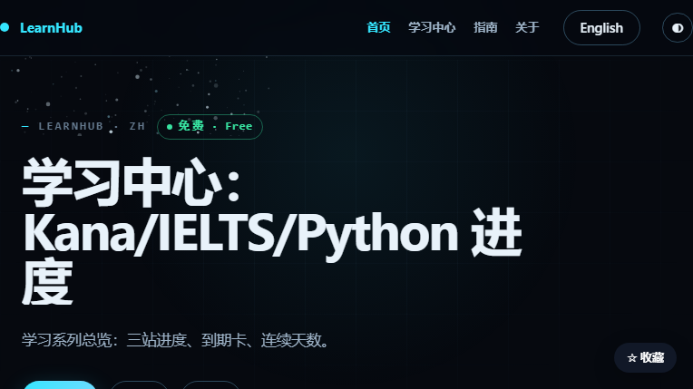

# LearnDojo

> **按身份和目标选课，1000 关遗忘曲线学习。**
>
> 英语 · 数学 · 编程 · 财务 · 科学 · 考试  
> 每关 10 题 · 1/3/7/14/30/60/120 天复习 · 9 段位 · 打卡图

官网：**https://learn.mengstone.com/**  
中文名：**学习道场 / LearnDojo**



---

## 这是什么

LearnDojo 不是“课程合集”，也不是“每天背 20 个单词”的打卡 App。

它把学习拆成：

```text
选身份 → 选目标 → 选难度 → 1000 关 → 每关 10 题
→ 积分解锁 → 1/3/7/14/30/60/120 天复习 → 段位与打卡
```

核心是 **主动回忆 + 间隔复习**，不是被动翻卡。

---

## 先选身份，再选目标

身份：

- 小学
- 初中
- 高中
- 大学
- 研究生
- 成人

目标：

- 备考中考
- 备考高考
- 备考研究生
- 个人提升
- 终身学习

系统根据身份和目标给出起步难度；选择只保存在本机，可随时改。

---

## 1000 关是怎么设计的

每个难度：

- 1000 关
- 每关 10 题
- 过关得积分
- 积分解锁下一关
- 9 个段位：青铜 → 王者
- 每关生成打卡图：段位、积分、连续天数

复习节奏：

```text
1 / 3 / 7 / 14 / 30 / 60 / 120 天
```

> 透明说明：1000 关按 10 题/关生成；同一难度内题目会重复出现，用来形成间隔复习，不是 1000 道完全不重复的新题。

---

## 课程范围

| 科目 | 覆盖 | 规模 |
|---|---|---|
| 英语词汇 | A1 / A2 / B1 / B2 | 4 × 1000 关 |
| 英语语法 | 基础 / 进阶 / 高阶 / 挑战 | 4 × 1000 关 |
| 数学 | 算术 / 代数 / 几何 / 统计 | 16 个难度，16,000 关 |
| 编程 | Python / JavaScript / SQL / 正则 | 16 个难度，16,000 关 |
| 财务 | 财务公式 / 比率 / 会计分录 | 专项 deck |
| 科学 | 物理 / 化学 / 原子结构 / 地理 | 专项 deck |
| 考试 | 英语语法 / 雅思 / 会计 / 财务 | 专项 deck |

总计 **41 套 deck**，覆盖从入门到考试。

---

## 为什么不是“收藏夹学习”

多数人的学习问题不是“没资料”，而是：

1. 不知道从哪个难度开始
2. 看完就忘，没有复习节奏
3. 被动阅读，没有主动回忆
4. 没有反馈，坚持不下去

LearnDojo 对应四件事：

| 问题 | 设计 |
|---|---|
| 不知道从哪开始 | 先选身份 + 目标，给起步难度 |
| 看完就忘 | 1/3/7/14/30/60/120 天复习 |
| 被动学习 | 每关 10 题，先想再答 |
| 坚持不了 | 积分、段位、打卡图 |

---

## 适合谁

- 想系统学英语，但不想再买一套“永久吃灰”的课的人
- 备考中/高考、考研、雅思，需要刷题节奏的人
- 想学 Python / JavaScript / SQL / 正则的初学者
- 想用碎片时间做主动回忆的人
- 喜欢关卡、段位、打卡反馈的人

## 不适合谁

- 想找“一天背完 5000 词”的人
- 需要真人老师逐题讲解的人
- 需要证书/学历认证的人

---

## English overview

**LearnDojo** is a Chinese-first micro-learning site built around **1000-level decks** and spaced repetition.

- Choose an identity (primary school → adult) and a goal (exam prep or self-improvement)
- Each level has 10 questions; 1000 levels per difficulty
- Review intervals: 1 / 3 / 7 / 14 / 30 / 60 / 120 days
- Points unlock levels; 9 ranks from Bronze to King
- Shareable check-in cards with rank, points and streak
- 41 decks across English, math, programming, finance, science and exams

The English decks cover A1–B2 vocabulary and grammar; math and programming each have 16 difficulties (16,000 levels).

Official site: **https://learn.mengstone.com/**

---

## 说明

- 这是产品介绍仓库，不是开源代码仓库。
- 课程数量、难度、价格/会员权益以官网为准。
- “1000 关”是关卡数，不等于 1000 道完全不重复的新题；同难度内会重复出现以形成间隔复习。
- 由萌石科技团队维护。

**官网：https://learn.mengstone.com/**
